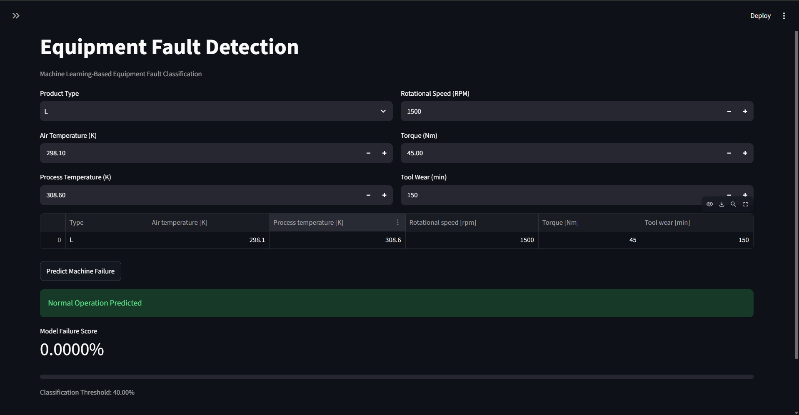

# Equipment Fault Detection Using Machine Learning

**Python | Scikit-learn | Pandas | Random Forest | Logistic Regression | Streamlit**

## 1. Project Overview

This project develops a machine learning-based equipment fault classification system using Python and the AI4I 2020 Predictive Maintenance Dataset. The objective is to classify machine operating observations as either normal (0) or failure (1) based on operating measurements.

Three classification approaches were implemented and compared: a majority-class baseline, Logistic Regression, and Random Forest.

The project includes exploratory data analysis, data preprocessing, model training, evaluation, hyperparameter tuning using GridSearchCV, and classification threshold optimisation.

An interactive Streamlit dashboard allows users to input machine operating measurements, obtain failure classifications, view model-generated failure scores, and receive warnings when inputs fall outside observed training ranges.

**Project scope:** This is an educational machine learning prototype. It classifies the failure status associated with individual observations and does not predict when future equipment failures will occur.

## Application Preview

The Streamlit dashboard allows users to enter machine operating
parameters and receive a fault classification and estimated
failure probability.



## 2. Dataset

**Source:** [UCI Machine Learning Repository — AI4I 2020 Predictive Maintenance Dataset](https://doi.org/10.24432/C5HS5C)

The project uses a synthetic dataset containing 10,000 machine operating observations and 14 original columns.

Six input features were selected:

| Feature | Description |
|---|---|
| Type | Product quality category: Low (L), Medium (M), High (H) |
| Air temperature [K] | Ambient air temperature in Kelvin |
| Process temperature [K] | Operating process temperature in Kelvin |
| Rotational speed [rpm] | Machine rotational speed |
| Torque [Nm] | Mechanical torque |
| Tool wear [min] | Accumulated tool wear |

The target variable, `Machine failure`, contains two classes:

- **0:** Normal operation
- **1:** Machine failure

### Exploratory Data Analysis

Initial analysis identified the following:

| Dataset characteristic | Finding |
|---|---:|
| Total observations | 10,000 |
| Original columns | 14 |
| Missing values | 0 |
| Normal observations | 9,661 (96.61%) |
| Failure observations | 339 (3.39%) |

### Class Imbalance

The dataset is highly imbalanced, with only 3.39% of observations representing machine failures.

A majority-class classifier achieves approximately 96.6% accuracy by always predicting normal operation, despite failing to identify any failures.

Therefore, accuracy alone is insufficient to evaluate model performance. Precision, recall, F1-score, and confusion matrices were used to assess failure-detection performance.

Identifier columns and failure-type indicators were excluded from the model inputs to avoid introducing irrelevant identifiers or leaking target information.

## 3. Technologies Used

| Technology | Purpose |
|---|---|
| Python | Main programming language |
| Pandas | Data manipulation and analysis |
| NumPy | Numerical operations |
| Scikit-learn | Preprocessing, classification, and evaluation |
| Matplotlib | Visualisation |
| Joblib | Saving and loading trained models |
| Streamlit | Interactive prediction dashboard |
| VS Code | Development environment |

## 4. Methodology

### 4.1 Data Preparation

The original dataset was separated into input features (`X`) and target labels (`y`).

An initial stratified split allocated:

- 80% (8,000 observations) to training and development
- 20% (2,000 observations) to an initial test set

For subsequent model-development experiments, the 8,000 training observations were further divided into:

| Subset | Observations | Purpose |
|---|---:|---|
| Development training | 6,400 | Model training and cross-validation |
| Validation | 1,600 | Model comparison and threshold selection |
| Initial test | 2,000 | Earlier exploratory evaluation |

Stratified splitting helped preserve approximately the same proportion of failures in each subset.

The initial test results were inspected during development. Therefore, they are not presented as a fully independent final assessment.

### 4.2 Data Preprocessing

The project uses Scikit-learn Pipelines and ColumnTransformer to prepare input features.

Numerical features are standardised using StandardScaler for Logistic Regression. The shared preprocessing approach also allows numerical transformations to be reused in the Random Forest pipeline, although tree-based models generally do not require scaling.

The categorical `Type` feature is converted into numerical indicators using OneHotEncoder.

These preprocessing operations are fitted on the training data and applied consistently to validation observations to prevent preprocessing-related data leakage.

### 4.3 Model Development

Three models were implemented.

**Majority-Class Baseline**

A DummyClassifier using the `most_frequent` strategy was implemented as a baseline. It always predicts the most common class, which is normal operation.

**Logistic Regression**

Logistic Regression was trained to estimate the relationship between machine operating measurements and failure labels.

Balanced class weights were used to increase consideration of the minority failure class.

**Random Forest**

Random Forest combines multiple decision trees to model potentially nonlinear relationships between operating features and machine failure.

Balanced class weights were also used for this classifier.

## 5. Model Evaluation

The models were trained on the same 6,400 development training observations and compared on the same 1,600-observation validation dataset.

### Validation Results

| Model | Accuracy | Precision | Recall | F1-score |
|---|---:|---:|---:|---:|
| Majority-Class Baseline | 96.62% | 0.00% | 0.00% | 0.00% |
| Logistic Regression | 82.31% | 14.33% | 85.19% | 24.53% |
| Random Forest | 98.00% | 82.35% | 51.85% | 63.64% |

Random Forest achieved the highest validation F1-score among the three models at their default classification settings.

Logistic Regression achieved higher failure recall but generated significantly more false-positive predictions.

This demonstrated the importance of evaluating both missed failures and false alarms when selecting a classification model.

### Random Forest Confusion Matrix

At the default classification threshold of 0.50:

| | Predicted Normal | Predicted Failure |
|---|---:|---:|
| Actual Normal | 1,540 | 6 |
| Actual Failure | 26 | 28 |

The model correctly detected 28 out of 54 failures while incorrectly flagging six normal observations.

## 6. Model Optimisation

### 6.1 Hyperparameter Tuning

GridSearchCV was implemented to explore combinations of Random Forest hyperparameters.

The search evaluated:

- Number of trees: 100 and 200
- Maximum tree depth: 10 and unrestricted
- Minimum samples per leaf: 1 and 2

Three-fold stratified cross-validation was used, with F1-score as the selection metric.

**Best hyperparameters:**

| Hyperparameter | Selected value |
|---|---|
| n_estimators | 200 |
| max_depth | None |
| min_samples_leaf | 2 |

The best mean cross-validation F1-score was **57.83%**.

The selected configuration matched the original Random Forest settings. This indicates that the search did not find a superior configuration among the eight combinations evaluated.

### 6.2 Classification Threshold Optimisation

The default classification threshold was 0.50.

To investigate the trade-off between detecting failures and generating false alarms, five thresholds were evaluated using the validation dataset.

| Threshold | Precision | Recall | F1-score |
|---|---:|---:|---:|
| 0.20 | 41.90% | 81.48% | 55.35% |
| 0.30 | 51.32% | 72.22% | 60.00% |
| 0.40 | 62.07% | 66.67% | **64.29%** |
| 0.50 | 82.35% | 51.85% | 63.64% |
| 0.60 | 85.19% | 42.59% | 56.79% |

A threshold of **0.40** achieved the highest validation F1-score among those evaluated.

Compared with the default threshold, it:

- Increased detected failures from 28 to 36 out of 54.
- Reduced missed failures from 26 to 18.
- Increased false alarms from 6 to 22.
- Increased recall from 51.85% to 66.67%.

This demonstrates that lowering the threshold improves failure detection at the expense of precision.

The threshold was selected using validation data, so the reported performance is a development result rather than an independent final test result.

## 7. Streamlit Application

An interactive web application was developed using Streamlit.

### Features

**Machine Operating Inputs**

Users can enter six operating measurements, including temperatures, rotational speed, torque, tool wear, and product type.

**Failure Classification**

The application loads the saved Random Forest Pipeline and estimates a failure score using `predict_proba()`.

The score is compared against the selected threshold of 0.40 to classify the observation as normal or a potential machine failure.

**Prediction Visualisation**

The dashboard displays:

- Predicted operating status
- Model-generated failure score
- Visual score indicator
- Selected classification threshold

**Input Validation**

Numerical inputs are restricted to nonnegative values.

**Out-of-Range Warnings**

The application compares numerical measurements against the minimum and maximum values observed in the development training data.

If a measurement falls outside its observed training range, the application displays a warning that the prediction may be less reliable.

These ranges are not industrial safety limits, and passing the checks does not guarantee that an input combination is familiar to the model.

## 8. Running the Project Locally

### Requirements

- Python 3.12
- Project dependencies listed in `requirements.txt`

### Installation

Clone or download the repository and open its project directory.

Install dependencies:

```bash
python -m pip install -r requirements.txt
```

Download the dataset:

```bash
python download_dataset.py
```

Train and save the machine learning model:

```bash
python train.py
```

Launch the Streamlit dashboard:

```bash
python -m streamlit run app.py
```

Open the local URL displayed in the terminal, usually `http://localhost:8501`.

The dashboard loads the trained Pipeline from `artifacts/my_random_forest.joblib`.

Run the training script before launching the app if the saved model file is not present.

## 9. Project Limitations

**Synthetic dataset:** The AI4I 2020 dataset is simulated and may not accurately represent real industrial operating conditions.

**No future failure prediction:** The target indicates failure status associated with an observation. The model does not estimate remaining useful life or predict the time until a future failure.

**Class imbalance:** Machine failures account for only 3.39% of observations, limiting the number of positive examples available for learning and evaluation.

**False positives and false negatives:** Increasing recall through threshold adjustment also increases false alarms.

**Uncalibrated scores:** The Random Forest failure scores have not been independently calibrated or validated as real-world failure probabilities.

**Evaluation limitations:** The original test set was examined during initial experimentation. In addition, the chosen threshold was selected using validation performance. The reported validation scores may therefore be optimistic and should not be interpreted as unbiased final generalisation performance.

**Input distribution:** Individual feature-range checks do not detect every possible out-of-distribution combination.

**Deployment limitations:** The application has not been tested using live industrial sensors or validated for production maintenance decisions.

## 10. Future Improvements

Possible extensions include:

- Nested or repeated stratified cross-validation for more rigorous performance estimation.
- Evaluation on an independent dataset.
- Probability calibration and threshold selection based on maintenance costs.
- Additional methods for imbalanced classification.
- Feature importance and explainability analysis using permutation importance or SHAP.
- Integration with real equipment sensor data.
- Time-series modelling when timestamped operating and failure data are available.
- Model monitoring to detect distribution shifts.

## 11. Key Learnings

Through this project, I gained practical experience in:

- Preparing and analysing imbalanced classification datasets.
- Developing preprocessing pipelines using Scikit-learn.
- Implementing baseline, Logistic Regression, and Random Forest classifiers.
- Evaluating models using precision, recall, F1-score, and confusion matrices.
- Applying cross-validation and GridSearchCV for model selection.
- Optimising classification thresholds and analysing precision–recall trade-offs.
- Saving and loading trained models using Joblib.
- Building an interactive Streamlit application.
- Implementing input validation and training-range warnings.
- Understanding the limitations of synthetic data and machine learning evaluation.

## 12. Data Attribution

AI4I 2020 Predictive Maintenance Dataset, UCI Machine Learning Repository.

Dataset DOI: https://doi.org/10.24432/C5HS5C

The dataset is publicly available through the UCI Machine Learning Repository.